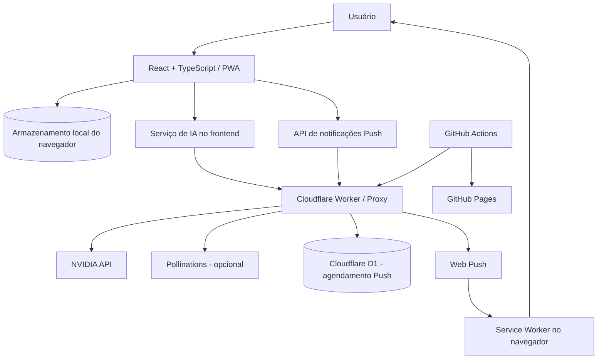

# Arquitetura do sistema

**Status:** descrição inicial baseada no código disponível em `main`.  
**Aplicação:** Remédio na Hora — PWA.

## 1. Visão geral

O produto é uma aplicação web cliente, construída com React, TypeScript e Vite, distribuída como Progressive Web App (PWA) pelo GitHub Pages. A interface concentra os dados do usuário no navegador. Integrações de inteligência artificial e notificações Push usam um serviço backend hospedado como Cloudflare Worker.

### Diagrama lógico

O diagrama representa os componentes identificados nos arquivos do projeto e deve ser ajustado se a infraestrutura mudar.

## 2. Camadas da aplicação

- **Interface:** componentes React em `src/components` e composição principal em `src/App.tsx`.
- **Domínio e tipos:** interfaces e enums em `src/types.ts`; regras auxiliares em `src/utils`.
- **Persistência local:** acesso e validação de dados em `src/storage.ts`, com chaves centralizadas e serialização JSON. A aplicação também importa uma camada de armazenamento seguro em `src/services/secureStorage`; o mecanismo criptográfico dessa camada deve ser documentado após revisão específica do arquivo.
- **Serviços externos:** integração de IA em `src/services/nvidiaService.ts`; notificações Push em `src/services/pushNotifications.ts`.
- **PWA:** manifesto em `public/manifest.webmanifest` e service worker em `public/sw.js`.
- **Infraestrutura:** workflows em `.github/workflows`; proxy e recursos de Push no diretório `worker/`.

## 3. Módulos funcionais identificados

- Lembretes de medicamentos, frequência, duração, horários e histórico de doses.
- Calendário e acompanhamento de doses.
- Cadastro de médicos e consultas.
- Cadastro de plano de saúde/cartão SUS.
- Registro de exames e resultados laboratoriais.
- Recursos de IA para leitura/importação de documentos, explicações, análises e apoio ao agendamento.
- Notificações locais e notificações Push, quando habilitadas.

A presença de uma tela ou serviço não significa que a saída de IA seja uma orientação clínica validada.

## 4. Integrações e fronteiras de confiança

O navegador não deve conter chaves privadas de provedores. O cliente chama o serviço central configurado internamente. O Worker mantém credenciais em secrets e encaminha requisições aos provedores.

A integração Push usa um token aleatório por dispositivo, enviado como Bearer token nas chamadas de registro, sincronização e cancelamento. O código cliente envia ao serviço uma lista de instantes UTC para agendamento; nomes de medicamentos, doses e histórico não fazem parte desse payload.

## 5. Decisões arquiteturais observadas

- Aplicação cliente, sem servidor de aplicação tradicional para renderização.
- Persistência primária local no dispositivo/navegador.
- Backup e restauração manuais por arquivo JSON, conforme descrito no README.
- Proxy central para integrações de IA.
- GitHub Actions para validações e publicação.
- PWA com cache de recursos e suporte a notificações Push.

## 6. Pontos que exigem confirmação técnica

1. Revisar a implementação completa de `secureStorage` para documentar algoritmo, derivação/gestão de chaves, bloqueio e recuperação.
2. Documentar o esquema real das tabelas D1 e as rotas do Worker a partir de `worker/`.
3. Confirmar política de retenção e exclusão de registros no backend.
4. Definir estratégia de migração/versionamento dos dados locais.
5. Documentar observabilidade, limites de requisição, disponibilidade e recuperação do Worker.
